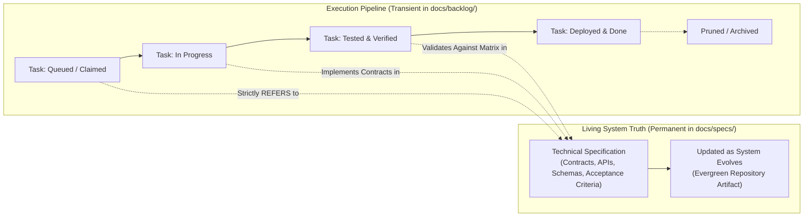
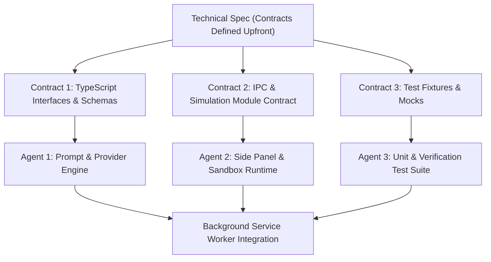

# Specification Authoring & Verifiable Engineering Workflow

This skill defines the requirements, architecture, and standards for writing technical specifications under `docs/specs/<feature-name>.md`. Every feature or backlog phase must be fully specified and approved before writing implementation code.

---

## 1. Lifecycle Architecture: Long-Lived Specs vs. Ephemeral Tasks

To keep the repository clean, maintainable, and aligned with architectural reality, agents and developers must strictly distinguish between **Living Specifications** and **Ephemeral Execution Tasks**:



### 1.1 Specifications (`docs/specs/`) — Long-Lived Architectural Truth
- **Permanent Assets**: Specs are evergreen documents that live indefinitely in the repository.
- **Scope**: Define system behavior, extension contracts (IPC envelopes, module contracts, declarative runtime schemas), data models, event interfaces, and verifiable verification matrices.
- **Maintenance**: When a feature evolves, its spec is updated in place. The spec remains the single source of truth for current and future agents/developers.

### 1.2 Backlog Tasks (`docs/backlog/`) — Ephemeral Execution Units
- **Transient Workflow Items**: Tasks represent transactional units of work (`queued` -> `in-progress` -> `tested` -> `done`).
- **Prunable**: Once completed, reviewed, and verified, task checklists may be archived or summarized without losing architectural knowledge.
- **The Golden Referral Rule**: **Backlog tasks must NEVER duplicate architectural details, schemas, or API contracts.** Instead, tasks must simply **REFER** to the living spec:
  - ❌ *Incorrect (Duplication):* `- [ ] Add StageGeometry parameter to init with width, height, dpr, and safeArea insets...`
  - ✅ *Correct (Referral):* `- [ ] Implement StageGeometry parameter injection conforming to [docs/specs/simulation_module_contract.md](file:///Users/waqqasmeraj/Developer/vmatrixdev/simit/docs/specs/simulation_module_contract.md)`.

### 1.3 Organize Specs by Feature Domain, Never by Project Phase
- **Domain-Oriented Cohesion**: Specifications describe cohesive features and target system states (`simulation_module_contract.md`, `simulation_verification.md`, `context_harvester.md`). They must **NEVER** be named or scoped by temporary delivery milestones (e.g. avoid `phase-1-...` or `sprint-3-...`).
- **Phasing is an Execution Concern (Owned by Backlog)**: The living spec defines what the system looks like and how its contracts interact. The **Backlog (`docs/backlog/tasks.md`)** is responsible for slicing that spec into deliverable phases, managing workstream decomposition, and coordinating sequencing across agents.

---

## 2. Core Principle: Verifiable Output

A specification must never rely on subjective definitions of completion (e.g., *"feature is implemented"* or *"simulation works as expected"*). Every deliverable must specify **verifiable outputs**:

1. **Automated Unit Verification**: Deterministic test suites run via `npm test` that pass with code 0 in `< 300ms` without making external network calls or spending LLM tokens.
2. **Automated Playwright E2E Verification**: End-to-end browser tests run via `npm run test:e2e` that launch Chromium, load the unpacked extension from `dist/`, verify Side Panel rendering, and assert zero runtime exceptions.
3. **Deterministic Contract Conformance**: TypeScript type checking via `npm run typecheck` (`tsc --noEmit`) passing with zero compilation or lint errors.
4. **Concrete Schemas & Interfaces**: Exact parameter types, StageGeometry dimensions, IPC envelope payloads, and ATIF trajectory formats documented for all interfaces.

---

## 3. Multi-Agent Parallelization & Contract-First Design

To enable multiple agents to work concurrently without stepping on each other's code, tasks are decomposed into **Independent** vs. **Dependent** workstreams using **Contract-First Architecture**.



### 3.1 Contract Types (Present & Future Interfaces)

Every spec must define concrete contracts before code is written:

1. **IPC & Messaging Contracts (`src/types/ipc.ts`)**:
   - Message envelopes (`type`, `requestId`, `payload`), response shapes, and error structures between Background Service Worker, Content Script, Offscreen Document, and Sandbox Iframe.
2. **TypeScript Domain Models (`src/types/`)**:
   - Authored directly in `src/types/<domain>.ts` as the single compileable source of truth.
   - Defined upfront with explicit input/output shapes, enums, and types.
   - Markdown specs reference these models via clickable links without line numbers (e.g. [`SimModule`](file:///Users/waqqasmeraj/Developer/vmatrixdev/simit/src/types/simulation.ts)). **Never hardcode line numbers (`#L...`)** because line numbers drift over time.
3. **Simulation Module Contracts (`src/runtime/module-contract.ts`)**:
   - `init(container, params, stage)`, `update(params)`, `destroy()`, and `explanation: { insight, legend, tour }`.
4. **Declarative Runtime Stack Schemas**:
   - Pinned declarative libraries (`Tweakpane v4`, `functionPlot v1`, `cytoscape v3`, `anime v3`, `d3 v7`, `katex v0.16`).

---

## 4. Lean & Executable Behavioral Verification

To avoid narrative bloat and keep specs compact (< 180 lines) for both human comprehension and LLM token ingestion, specs must **NEVER** write long paragraphs describing tests.

Instead, acceptance criteria must be defined using a **Compact Behavioral Acceptance Matrix** that maps 1:1 to deterministic unit tests (`npm test`).

### 4.1 Compact Acceptance Matrix Format

```markdown
| ID | Scenario | Given / State | When / Input | Expected Output | Verification Target |
| :--- | :--- | :--- | :--- | :--- | :--- |
| **C1** | Stage Geometry Derivation | Host viewport 400x600, drawer 44px, DPR 2 | `computeStageGeometry` evaluated | `width: 400, height: 556, dpr: 2` | `tests/module_contract.test.ts` |
| **C2** | Double Controls Prohibition | Coder prompt inspected | Searched for control directives | Contains explicit "never create a tweakpane" rule | `tests/module_contract.test.ts` |
| **C3** | Explanation Schema Validation | Module exports `explanation` object | `validateSimulationModuleContract` evaluated | Valid schema passes warning-free | `tests/module_contract.test.ts` |
```

---

## 5. Lean Specification Template

Every technical specification under `docs/specs/<feature-name>.md` should target **120-180 lines** of high-density architectural truth:

```markdown
# Technical Specification: <Feature Name>

**Status:** Draft | Under Review | Approved & Living Specification  
**Domain:** <Domain / Subsystem>  
**Living Document:** Permanent architectural specification under `docs/specs/`  
**Tracking Backlog:** [docs/backlog/tasks.md](file:///Users/waqqasmeraj/Developer/vmatrixdev/simit/docs/backlog/tasks.md)  
**Executable Test Suite:** [tests/<feature-name>.test.ts](file:///Users/waqqasmeraj/Developer/vmatrixdev/simit/tests/<feature-name>.test.ts)

---

## 1. Overview & Business Objectives
- Concise 1-2 paragraph functional summary.
- Expected user experience and key workflows.

---

## 2. Component Interaction & Architecture (Mermaid)
\`\`\`mermaid
flowchart TD
    A["Component A"] --> B["Component B"]
\`\`\`

---

## 3. Contracts & Data Models
- Domain types authored in `src/types/<domain>.ts`.
- Link to symbols: [`ModelName`](file:///Users/waqqasmeraj/Developer/vmatrixdev/simit/src/types/<domain>.ts).

---

## 4. Domain Invariants & Edge Cases
- Mathematical formulas, physical constraints, and safety guardrails.
- Fallback hierarchy for missing, ambiguous, or incoherent inputs.

---

## 5. Behavioral Acceptance Matrix
| ID | Scenario | Given / State | When / Input | Expected Output | Verification Target |
| :--- | :--- | :--- | :--- | :--- | :--- |
| **S1** | ... | ... | ... | ... | `tests/<feature>.test.ts` |
```

---

## 6. Spec Review Checklist

Before marking a spec as ready for implementation:
- [ ] Is the spec registered in the master index [docs/specs/index.md](file:///Users/waqqasmeraj/Developer/vmatrixdev/simit/docs/specs/index.md)?
- [ ] Are all contracts (TypeScript interfaces, parameters, IPC types) strongly typed and compileable?
- [ ] Is there a cohesive visual diagram (Mermaid flowchart, sequence, or state diagram)?
- [ ] Are edge cases and mathematical invariants explicitly stated?
- [ ] Is verification specified via a concise Behavioral Acceptance Matrix rather than long prose paragraphs?
- [ ] Does the spec link directly to its executable test suite?
