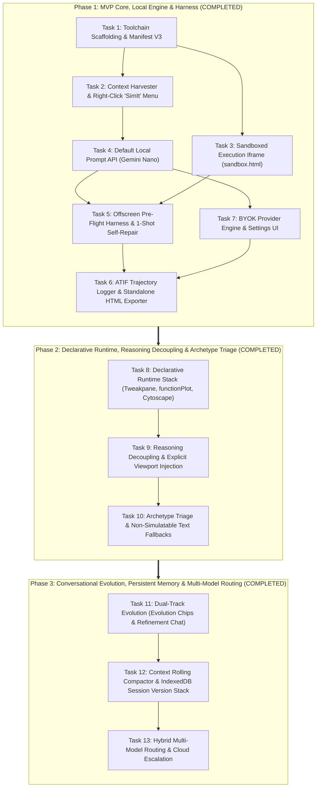

# SimIt Execution Backlog

**Lifecycle:** Ephemeral Backlog under `docs/backlog/`  
**Master Specifications:** [docs/specs/index.md](file:///Users/waqqasmeraj/.gemini/antigravity/worktrees/simit/improve_simulation_evaluation/docs/specs/index.md)  
**Roadmap Source:** [docs/product/roadmap.md](file:///Users/waqqasmeraj/.gemini/antigravity/worktrees/simit/improve_simulation_evaluation/docs/product/roadmap.md)  

---

## Workstream Decomposition & Dependency Graph

---

## Phase 5 Execution Checklist (Status: Completed - P0 Robustness & Verification Harness)

### Step 15: Multimodal Image Wire Protocol & Provider Integration
- [x] Implement `src/providers/multimodal.ts` mapping pure `ImageAttachment` arrays to Gemini `inline_data`, Anthropic base64 images, and OpenAI `image_url` payloads conforming to [docs/specs/model_providers.md](file:///Users/waqqasmeraj/.gemini/antigravity/worktrees/simit/improve_simulation_evaluation/docs/specs/model_providers.md).
- [x] Wire image attachments into `GoogleGeminiProvider`, `AnthropicProvider`, and `OpenAICompatibleProvider` conforming to [docs/specs/model_providers.md](file:///Users/waqqasmeraj/.gemini/antigravity/worktrees/simit/improve_simulation_evaluation/docs/specs/model_providers.md).
- [x] Pass `tests/multimodal_mapping.test.ts` unit test suite conforming to [docs/specs/model_providers.md](file:///Users/waqqasmeraj/.gemini/antigravity/worktrees/simit/improve_simulation_evaluation/docs/specs/model_providers.md).

### Step 16: Simulation Module Contract & Stage Geometry
- [x] Implement `src/runtime/module-contract.ts` single-source prompt generator (`buildModuleContractPromptSection`), `computeStageGeometry`, and `dispatchParameterUpdate` conforming to [docs/specs/simulation_module_contract.md](file:///Users/waqqasmeraj/.gemini/antigravity/worktrees/simit/improve_simulation_evaluation/docs/specs/simulation_module_contract.md).
- [x] Integrate single-source contract into `agent-orchestrator.ts` and `prompt-builder.ts` eliminating duplicate Tweakpanes and docking `#pane-dock` as a bottom controls drawer conforming to [docs/specs/simulation_module_contract.md](file:///Users/waqqasmeraj/.gemini/antigravity/worktrees/simit/improve_simulation_evaluation/docs/specs/simulation_module_contract.md).
- [x] Pass `tests/module_contract.test.ts` unit test suite conforming to [docs/specs/simulation_module_contract.md](file:///Users/waqqasmeraj/.gemini/antigravity/worktrees/simit/improve_simulation_evaluation/docs/specs/simulation_module_contract.md).

### Step 17: Pre-Flight Verification Harness & Automated Diagnostics
- [x] Implement pure diagnostic algorithms (`computeRasterStats`, `isBlankRender`, `scanNonFiniteText`, `detectDuplicateControls`, `detectCanvasSizing`, `buildSweepPlan`) and multi-phase `verifySimulationInStage` runner in `src/runtime/verification.ts` conforming to [docs/specs/simulation_verification.md](file:///Users/waqqasmeraj/.gemini/antigravity/worktrees/simit/improve_simulation_evaluation/docs/specs/simulation_verification.md).
- [x] Refactor offscreen harness (`offscreen.html`) and sandbox runtime (`sandbox.ts`) to mount visibly offscreen (`position: fixed; left: -10000px`) at active panel dimensions and soak across rAF frames conforming to [docs/specs/simulation_verification.md](file:///Users/waqqasmeraj/.gemini/antigravity/worktrees/simit/improve_simulation_evaluation/docs/specs/simulation_verification.md).
- [x] Implement IPC protocol handlers for `SANDBOX_VERIFY_SIMULATION` and `SANDBOX_VERIFICATION_REPORT` conforming to [docs/specs/sandbox_ipc.md](file:///Users/waqqasmeraj/.gemini/antigravity/worktrees/simit/improve_simulation_evaluation/docs/specs/sandbox_ipc.md).
- [x] Pass `tests/verification_harness.test.ts` unit test suite conforming to [docs/specs/simulation_verification.md](file:///Users/waqqasmeraj/.gemini/antigravity/worktrees/simit/improve_simulation_evaluation/docs/specs/simulation_verification.md).

### Step 18: Code Patching Revisions & Quality Flags
- [x] Update `executeAutonomousSimulationLoop` in `src/runtime/agent-orchestrator.ts` to feed previous code, full stack traces, and diagnostics back to Coder on revision conforming to [docs/specs/autonomous_agent_architecture.md](file:///Users/waqqasmeraj/.gemini/antigravity/worktrees/simit/improve_simulation_evaluation/docs/specs/autonomous_agent_architecture.md).
- [x] Attach rendered raster frames directly to vision review prompt `images` payload conforming to [docs/specs/autonomous_agent_architecture.md](file:///Users/waqqasmeraj/.gemini/antigravity/worktrees/simit/improve_simulation_evaluation/docs/specs/autonomous_agent_architecture.md).
- [x] Emit explicit `QualityFlag` warnings when fallbacks or parse errors occur conforming to [docs/specs/autonomous_agent_architecture.md](file:///Users/waqqasmeraj/.gemini/antigravity/worktrees/simit/improve_simulation_evaluation/docs/specs/autonomous_agent_architecture.md).

---

## Phase 6 Execution Checklist (Status: Completed - P1 Pedagogical Explanation & Live Guided Tour)

### Step 19: Architect Pedagogy Phase, Source Context Forwarding & Pedagogical Review
- [x] Extend `DELEGATE_TO_CODER_TOOL`, `buildArchitectSystemPrompt`, `normalizeCoderPlan`, `buildCoderUserPrompt`, and `buildArchitectReviewPrompt` in `src/runtime/agent-orchestrator.ts` conforming to [docs/specs/autonomous_agent_architecture.md](file:///Users/waqqasmeraj/.gemini/antigravity/worktrees/simit/improve_simulation_evaluation/docs/specs/autonomous_agent_architecture.md).
- [x] Generate guided exploration chips from `explanation.tour` in `src/runtime/evolution.ts` and `src/background/service-worker.ts` conforming to [docs/specs/autonomous_agent_architecture.md](file:///Users/waqqasmeraj/.gemini/antigravity/worktrees/simit/improve_simulation_evaluation/docs/specs/autonomous_agent_architecture.md).

### Step 20: Module Explanation Contract & Host-Rendered Guided Tour Bar
- [x] Implement `validateSimulationModuleContract` and document `explanation: { insight, legend, tour }` in `src/runtime/module-contract.ts` conforming to [docs/specs/simulation_module_contract.md](file:///Users/waqqasmeraj/.gemini/antigravity/worktrees/simit/improve_simulation_evaluation/docs/specs/simulation_module_contract.md).
- [x] Render `#explanation-dock` and `#tour-bar` in `src/sandbox/sandbox.html`, `src/sandbox/sandbox.css`, `src/sandbox/sandbox.ts`, and `src/export/standalone-exporter.ts` conforming to [docs/specs/simulation_module_contract.md](file:///Users/waqqasmeraj/.gemini/antigravity/worktrees/simit/improve_simulation_evaluation/docs/specs/simulation_module_contract.md).

