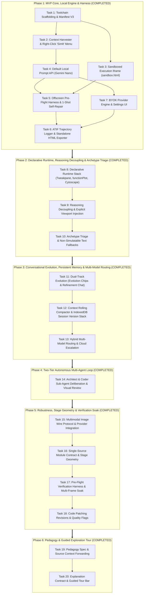

# SimIt Execution Backlog

**Lifecycle:** Ephemeral Backlog under `docs/backlog/`  
**Master Specifications:** [docs/specs/index.md](file:///Users/waqqasmeraj/Developer/vmatrixdev/simit/docs/specs/index.md)  
**Roadmap Source:** [docs/product/roadmap.md](file:///Users/waqqasmeraj/Developer/vmatrixdev/simit/docs/product/roadmap.md)  

---

## Workstream Decomposition & Dependency Graph

---

## Completed Phases Summary

- **Phase 1 (MVP Core & Harness)**: Manifest V3 extension, context harvester, sandboxed iframe, Prompt API, offscreen pre-flight harness, ATIF logger, and BYOK providers. Conforming to [docs/specs/architecture.md](file:///Users/waqqasmeraj/Developer/vmatrixdev/simit/docs/specs/architecture.md).
- **Phase 2 (Declarative Runtime & Triage)**: Tweakpane, functionPlot, Cytoscape, Math.js runtime stack, `<simulation_thinking>` decoupling, and upfront archetype triage. Conforming to [docs/specs/declarative_runtime.md](file:///Users/waqqasmeraj/Developer/vmatrixdev/simit/docs/specs/declarative_runtime.md) and [docs/specs/archetype_triage.md](file:///Users/waqqasmeraj/Developer/vmatrixdev/simit/docs/specs/archetype_triage.md).
- **Phase 3 (Evolution, Session & Routing)**: Evolution chips, refinement chat, IndexedDB session stack, context compactor, and hybrid model routing. Conforming to [docs/specs/conversational_evolution.md](file:///Users/waqqasmeraj/Developer/vmatrixdev/simit/docs/specs/conversational_evolution.md), [docs/specs/session_memory.md](file:///Users/waqqasmeraj/Developer/vmatrixdev/simit/docs/specs/session_memory.md), and [docs/specs/model_routing.md](file:///Users/waqqasmeraj/Developer/vmatrixdev/simit/docs/specs/model_routing.md).
- **Phase 4 (Autonomous Multi-Agent Loop)**: Two-tier Epistemic Architect and Coder sub-agents, unconstrained deliberation, and micro-progress reporting. Conforming to [docs/specs/autonomous_agent_architecture.md](file:///Users/waqqasmeraj/Developer/vmatrixdev/simit/docs/specs/autonomous_agent_architecture.md).
- **Phase 5 (Robustness & Verification Soak)**: Multimodal image wire protocol (`src/providers/multimodal.ts`), single-source contract (`src/runtime/module-contract.ts`), `StageGeometry`, pre-flight multi-frame soak verification runner (`src/runtime/verification.ts`), and code-patching revisions. Conforming to [docs/specs/simulation_module_contract.md](file:///Users/waqqasmeraj/Developer/vmatrixdev/simit/docs/specs/simulation_module_contract.md) and [docs/specs/simulation_verification.md](file:///Users/waqqasmeraj/Developer/vmatrixdev/simit/docs/specs/simulation_verification.md).
- **Phase 6 (Pedagogy & Guided Tour)**: `PedagogySpec` (`coreInsight`, `misconception`, `ahaExperiment`), explanation contract (`insight`, `legend`, `tour`), and host-rendered tour controls (`#tour-bar`). Conforming to [docs/specs/simulation_module_contract.md](file:///Users/waqqasmeraj/Developer/vmatrixdev/simit/docs/specs/simulation_module_contract.md) and [docs/specs/autonomous_agent_architecture.md](file:///Users/waqqasmeraj/Developer/vmatrixdev/simit/docs/specs/autonomous_agent_architecture.md).

---

## Active Backlog Tasks

- [ ] Chrome Web Store asset finalization and store submission conforming to [docs/product/chrome_web_store_publishing.md](file:///Users/waqqasmeraj/Developer/vmatrixdev/simit/docs/product/chrome_web_store_publishing.md).

