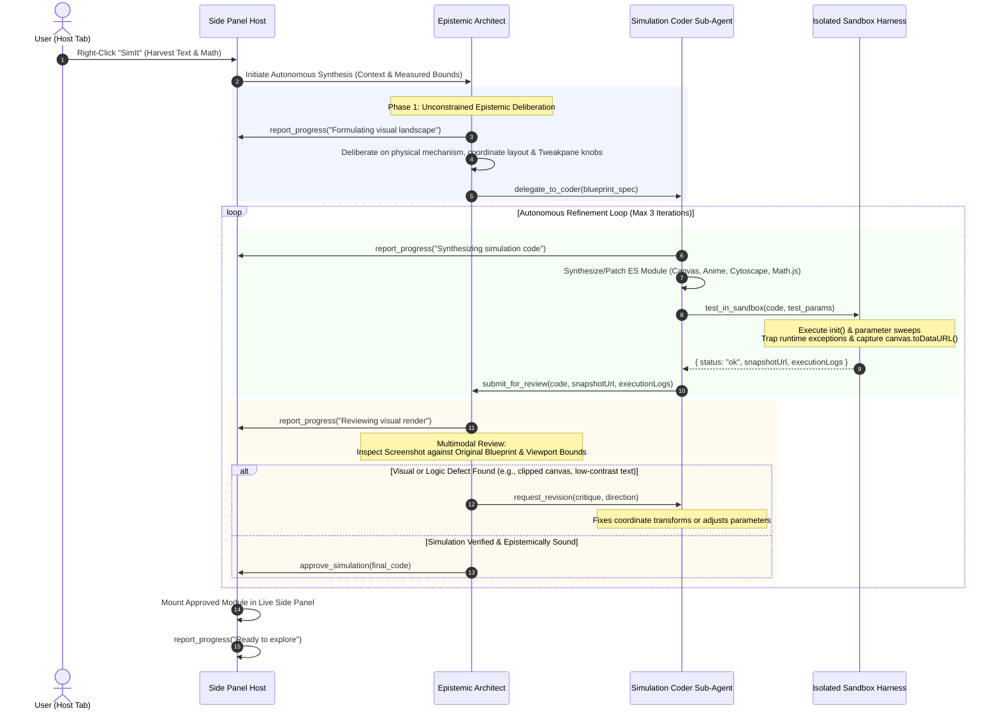

# Technical Specification: Autonomous Multi-Agent Loop, Creative Deliberation & Multimodal Visual Review

**Status:** Approved & Living Specification  
**Domain:** Autonomous Multi-Agent Orchestration, Creative Visual Deliberation, and Multimodal Sandbox Review  
**Living Document:** Permanent architectural specification under `docs/specs/`  
**Tracking Backlog:** [docs/backlog/tasks.md](file:///Users/waqqasmeraj/Developer/vmatrixdev/simit/docs/backlog/tasks.md)  
**Executable Test Suite:** [tests/agent_orchestrator.test.ts](file:///Users/waqqasmeraj/Developer/vmatrixdev/simit/tests/agent_orchestrator.test.ts)

---

## 1. Overview & Problem Definition

Earlier iterations of SimIt relied on **single-shot prompt synthesis** combined with **rigid regex archetype triage** (slotting inputs into 5 predefined categories like `parameter_explorer`, `step_scrubber`, or static `concept_dag`). 

This architecture produced two major bottlenecks:
1. **The Archetype Handcuff**: Highlighting complex concepts (such as Transformer Multi-Head Attention, Kalman Filters, or Distributed Consensus) triggered rigid categorization, suppressing novel or bespoke visual metaphors.
2. **The Single-Shot Dilution**: Asking a model in a single prompt to simultaneously invent the mental model, derive coordinate geometry, plan controls, and write 150+ lines of robust ES module code forced even frontier reasoning models into conservative, formulaic boilerplate.
3. **Pigeonholed Deliberation**: Providing formulaic 3-bullet thinking examples anchored the model into superficial summaries rather than deep spatial and mathematical deliberation.

This specification defines the **Two-Tier Autonomous Multi-Agent Architecture**:
- **Epistemic Architect**: An unconstrained deliberation agent that invents the interactive mental model and control plane.
- **Simulation Coder**: A specialized sub-agent that translates blueprints into executable ES modules.
- **Headless Sandbox Harness**: An execution environment providing live visual raster snapshots (`canvas.toDataURL()`).
- **Multimodal Visual Review**: An iterative critique loop where the Architect reviews rendered screenshots against the original plan before user presentation.
- **Micro-Progress Reporting**: Concise, punchy 3–5 word status indicators without role prefixes.

---

## 2. End-to-End Autonomous Agent Loop



---

## 3. Micro-Progress Reporting Contract (3–5 Words, Zero Role Noise)

To maintain an uncluttered UI in the Chrome Side Panel, progress updates are naturally constrained to concise, user-centric action summaries.

### 3.1 Contract Definition
```typescript
export interface ReportProgressPayload {
  /**
   * Strictly 1 line, 3-5 words describing current action (e.g. "Synthesizing simulation code").
   */
  status: string;
}
```

### 3.2 Design & Format Guidelines
1. **Direct Action Summaries**: Prompts instruct the model to report its active step directly in 3–5 words (e.g., `"Formulating visual landscape"`, `"Synthesizing simulation code"`, `"Testing boundary parameters"`).
2. **UI Fit**: Formatted on a single line to fit cleanly inside the Side Panel header status pill (`#status-pill`) and morphing progress dock.
3. **Defensive Normalization**: The runtime ensures strings are clean, single-line, and bounded to <= 5 words before rendering in the UI.

### 3.3 Example Progress Lexicon
- `"Formulating visual landscape"`
- `"Synthesizing simulation code"`
- `"Testing boundary parameters"`
- `"Reviewing visual render"`
- `"Refining coordinate scaling"`
- `"Polishing interactive controls"`
- `"Ready to explore"`

---

## 4. Sandbox Visual Snapshot Tool

The isolated evaluation sandbox (`sandbox.html` inside `offscreen.html` or hidden iframe) executes generated JavaScript and captures a live visual raster snapshot.

### 4.1 Evaluation Payload Contract
```typescript
export interface SandboxEvaluationResult {
  status: 'ok' | 'error';
  errorMessage?: string;
  errorStack?: string;
  logs: string[];
  parameters: ParameterDefinition[];
  snapshotUrl?: string; // WebP or PNG data URI
  executionTimeMs: number;
}
```

### 4.2 Snapshot Capture Invariants
1. **Canvas Rasterization**: If a `<canvas>` element exists in the container, invoke `canvas.toDataURL('image/webp', 0.85)` (with PNG fallback).
2. **SVG Vector Serialization**: If an `<svg>` element exists (e.g. functionPlot, custom SVG), serialize the DOM XML to an encoded data URI: `data:image/svg+xml;charset=utf-8,...`.
3. **Headless & Fallback Mode**: When running in headless test harnesses (such as JSDOM) where canvas pixel backings are absent, return a deterministic base64 placeholder data URI to preserve multimodal contract verification.

---

## 5. Epistemic Architect & Coder Prompts (Decoupled Specialization)

### 5.1 The Epistemic Architect System Prompt, Pedagogy Phase & Standard Tool Call
The Architect has **complete creative freedom** over the declarative library suite (`Tweakpane`, `Canvas 2D`, `Anime.js`, `Cytoscape`, `KaTeX`, `Math.js`, `jStat`, `Matter.js`, `functionPlot`, `glMatrix`). Before visual layout design, the Architect executes a **Pedagogy Phase** to ensure newcomer comprehension:
1. **Core Insight (`coreInsight`)**: Single core takeaway in one plain-English sentence.
2. **Prerequisites (`prerequisites`)**: 2–3 foundational concepts a newcomer must recognize on screen.
3. **Target Misconception (`misconception`)**: Common misconception disproved by the visual dynamics.
4. **Aha Experiment (`ahaExperiment`)**: Concrete "try this -> notice that" parameter manipulation that makes the insight click.
5. **Source Symbol Legend (`symbolMap` & `explanation.legend`)**: Mapping of source variables/symbols (`symbol`, `meaning`, `color`) to visual elements.
6. **Live Guided Tour (`explanation.tour`)**: A 2–4 step walkthrough where each step specifies `caption`, `params` overrides, optional `highlight`, `tryThis`, and `noticeThat`.
   - **Invariant**: Guided tours (`explanation.tour`) must drive the live simulation model via parameter updates (`params` passed to `update(params)`); never hardcode static frames or disconnected slides.

#### Standard Tool Specification (`DELEGATE_TO_CODER_TOOL`):
```typescript
export const DELEGATE_TO_CODER_TOOL = {
  name: 'delegate_to_coder',
  description: 'Delegates the simulation specification to the Simulation Coder sub-agent.',
  parameters: {
    type: 'object',
    properties: {
      title: { type: 'string', description: 'Simulation title' },
      description: { type: 'string', description: '1-line epistemic summary' },
      visualPlan: { type: 'string', description: 'Layout, visual metaphors, coordinate system, dynamic elements' },
      mathFormulation: { type: 'string', description: 'Mathematical formulation or algorithm logic' },
      parametersSpec: {
        type: 'array',
        description: 'Interactive parameters for controls',
        items: {
          type: 'object',
          properties: {
            id: { type: 'string' },
            label: { type: 'string' },
            type: { type: 'string', enum: ['slider', 'toggle', 'stepper', 'button'] },
            min: { type: 'number' },
            max: { type: 'number' },
            step: { type: 'number' },
            default: { type: ['number', 'boolean', 'string'] },
            unit: { type: 'string' }
          },
          required: ['id', 'label', 'type', 'default']
        }
      },
      directInteractionSpec: { type: 'string', description: 'Direct canvas drag/tap/hover interaction dynamics' },
      pedagogy: {
        type: 'object',
        description: 'Pedagogical blueprint for newcomer comprehension'
      },
      explanation: {
        type: 'object',
        description: 'Host-rendered explanation and live parameter-driven guided tour'
      }
    },
    required: ['title', 'description', 'visualPlan', 'mathFormulation', 'parametersSpec']
  }
};
```

### 5.2 The Simulation Coder Sub-Agent System & User Prompts
The Coder sub-agent receives:
- The Architect's formal blueprint (`title`, `description`, `visualPlan`, `mathFormulation`, `parametersSpec`, `directInteractionSpec`, `pedagogy`, `explanation`)
- The full harvested source context (`context.selection.selectedText`, `context.mathSnippets`, `context.domContext.nearestHeading`, `context.domContext.caption`, `context.domContext.paragraphSnippet`)
- The single-source Simulation Module Contract (`buildModuleContractPromptSection`)

### 5.3 The Multimodal Visual & Pedagogical Review Prompt & Revision Protocol
When the sandbox evaluation completes, the Architect reviews the verified code, diagnostics, and rendered snapshot frames against 8 criteria (4 visual/technical + 4 pedagogical):
1. **Legibility & Contrast**: Visual labels clear on dark background (`#090d16`).
2. **Viewport Geometry**: Fits cleanly inside stage without clipping or letterbox borders.
3. **Epistemic Truth**: Faithfully reflects the physical/mathematical model.
4. **Control Usability**: Parameters responsive across boundary values.
5. **Newcomer Element Identifiability**: Every visual element is identifiable via clear on-canvas labels or `explanation.legend`.
6. **Default Insight Visibility**: Default parameter state immediately demonstrates `pedagogy.coreInsight` / `explanation.insight`.
7. **Source Symbol Consistency**: Symbols on screen and in `explanation.legend` match the source equations and text.
8. **Live Parameter-Driven Tour**: `explanation.tour` drives the live simulation model via real `params` updates passed to `update(params)` rather than static slides.

#### Revision Protocol & Code Patching:
When revision is requested or runtime errors/diagnostics are caught:
- The previous code MUST be fed back to the Coder agent inside `<previous_code>`.
- Full stack traces, failed line/column numbers, and parameter singularity states are provided.
- The Coder patches the existing implementation rather than generating a random variation from scratch.
- If review parsing fails or errors occur, `approved: false` is triggered with `QualityFlag` warnings attached (never silent fallback).

---

## 6. Shared TypeScript Domain Contracts

Contracts are authored under [`src/types/agent.ts`](file:///Users/waqqasmeraj/Developer/vmatrixdev/simit/src/types/agent.ts), [`src/types/simulation.ts`](file:///Users/waqqasmeraj/Developer/vmatrixdev/simit/src/types/simulation.ts), [`src/types/verification.ts`](file:///Users/waqqasmeraj/Developer/vmatrixdev/simit/src/types/verification.ts), and [`src/types/ipc.ts`](file:///Users/waqqasmeraj/Developer/vmatrixdev/simit/src/types/ipc.ts):
- [`PedagogySpec`](file:///Users/waqqasmeraj/Developer/vmatrixdev/simit/src/types/simulation.ts): `coreInsight`, `prerequisites`, `misconception`, `ahaExperiment`, and `symbolMap`.
- [`SimulationExplanation`](file:///Users/waqqasmeraj/Developer/vmatrixdev/simit/src/types/simulation.ts): `insight`, `legend`, and `tour`.
- [`CoderPlanSpec`](file:///Users/waqqasmeraj/Developer/vmatrixdev/simit/src/types/agent.ts): Blueprint formulated by the Architect and dispatched to the Coder.
- [`RevisionContext`](file:///Users/waqqasmeraj/Developer/vmatrixdev/simit/src/types/agent.ts): Previous code, diagnostics, stack traces, and critique for code patching.
- [`QualityFlag`](file:///Users/waqqasmeraj/Developer/vmatrixdev/simit/src/types/agent.ts): Explicit flags emitted when degraded fallback paths are taken.
- [`ReviewFeedback`](file:///Users/waqqasmeraj/Developer/vmatrixdev/simit/src/types/agent.ts): Critique and approval decision from the Architect.
- [`AutonomousLoopResult`](file:///Users/waqqasmeraj/Developer/vmatrixdev/simit/src/types/agent.ts): Final synthesis result delivered to Side Panel host with quality flags, `pedagogy`, and `explanation`.

---

## 7. Behavioral Acceptance Matrix

| ID | Scenario | Given / State | When / Input | Expected Output | Verification Target |
| :--- | :--- | :--- | :--- | :--- | :--- |
| **A1** | Micro-Status Prefix Stripping | Model produces `"Architect: Formulating visual landscape"` | `validateMicroStatus` evaluated | Returns `"Formulating visual landscape"` with zero role prefix | `tests/agent_orchestrator.test.ts` |
| **A2** | Micro-Status Length Bound | Model produces 12-word status text | `validateMicroStatus` evaluated | Clamped strictly to $\le 5$ words on a single line | `tests/agent_orchestrator.test.ts` |
| **A3** | Sandbox Snapshot Capture | Module renders canvas in sandbox | Preflight test completes | Returns `snapshotUrl` containing valid image data URI | `tests/agent_orchestrator.test.ts` |
| **A4** | Visual Defect Critique Loop | Coder renders clipped mass; Architect inspects screenshot | Architect review evaluated | Emits `approved: false` with targeted critique and direction | `tests/agent_orchestrator.test.ts` |
| **A5** | Code Revision Patching | Coder receives previous code and critique | Second turn evaluated | Patches previous code rather than restarting; passes review | `tests/agent_orchestrator.test.ts` |
| **A6** | Runtime Crash Recovery | Coder produces code throwing runtime exception | Sandbox detects exception | Error stack & params fed to Coder; patches code successfully | `tests/agent_orchestrator.test.ts` |
| **A7** | Multimodal Image Payload | Review prompt assembled for vision provider | `buildArchitectReviewPrompt` evaluated | Attaches raster image objects to `images` payload, not text truncations | `tests/agent_orchestrator.test.ts` |
| **A8** | Loud Fallback Quality Flags | Review output unparseable JSON | Review evaluation fails | Rejects approval, records `REVIEW_UNPARSEABLE` flag in `AutonomousLoopResult` | `tests/agent_orchestrator.test.ts` |
| **A9** | Pedagogy & Explanation Propagation | Architect emits `pedagogy` & `explanation` in `delegate_to_coder` | `executeAutonomousSimulationLoop` evaluated | Forwards full source context, equations, DOM context, pedagogy, and explanation to Coder and returns `explanation` on result | `tests/agent_orchestrator.test.ts` |


