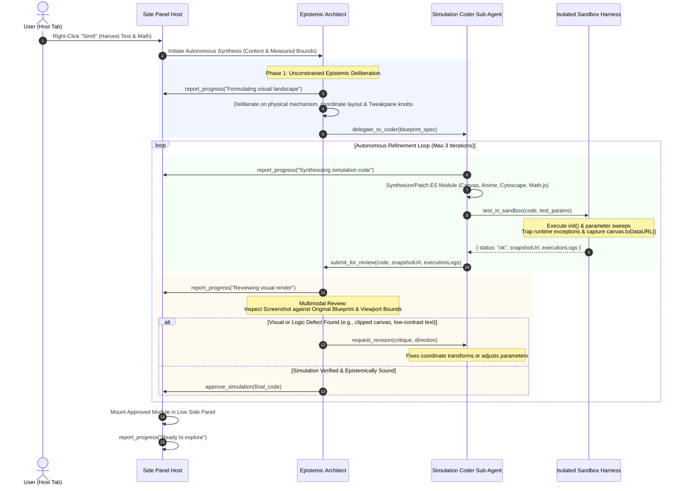

# Technical Specification: Autonomous Multi-Agent Loop, Creative Deliberation & Multimodal Visual Review

**Status:** Approved & Living Specification  
**Domain:** Autonomous Multi-Agent Orchestration, Creative Visual Deliberation, and Multimodal Sandbox Review  
**Living Document:** Permanent architectural specification under `docs/specs/`  
**Tracking Backlog:** [docs/backlog/tasks.md](file:///Users/waqqasmeraj/Developer/vmatrixdev/simit/docs/backlog/tasks.md)  
**Executable Test Suite:** [tests/agent_orchestrator.test.ts](file:///Users/waqqasmeraj/Developer/vmatrixdev/simit/tests/agent_orchestrator.test.ts)

---

## 1. Overview & Problem Definition

Earlier iterations of SimIt relied on **single-shot prompt synthesis** combined with **rigid regex archetype triage** (slotting inputs into 5 predefined categories like `parameter_explorer`, `step_scrubber`, or static `concept_dag`). 

This architecture produced two major bottlenecks:
1. **The Archetype Handcuff**: Highlighting complex concepts (such as Transformer Multi-Head Attention, Kalman Filters, or Distributed Consensus) triggered rigid categorization, suppressing novel or bespoke visual metaphors.
2. **The Single-Shot Dilution**: Asking a model in a single prompt to simultaneously invent the mental model, derive coordinate geometry, plan controls, and write 150+ lines of robust ES module code forced even frontier reasoning models into conservative, formulaic boilerplate.
3. **Pigeonholed Deliberation**: Providing formulaic 3-bullet thinking examples anchored the model into superficial summaries rather than deep spatial and mathematical deliberation.

This specification defines the **Two-Tier Autonomous Multi-Agent Architecture**:
- **Epistemic Architect**: An unconstrained deliberation agent that invents the interactive mental model and control plane.
- **Simulation Coder**: A specialized sub-agent that translates blueprints into executable ES modules.
- **Headless Sandbox Harness**: An execution environment providing live visual raster snapshots (`canvas.toDataURL()`).
- **Multimodal Visual Review**: An iterative critique loop where the Architect reviews rendered screenshots against the original plan before user presentation.
- **Micro-Progress Reporting**: Concise, punchy 3–5 word status indicators without role prefixes.

---

## 2. End-to-End Autonomous Agent Loop



---

## 3. Micro-Progress Reporting Contract (3–5 Words, Zero Role Noise)

To maintain an uncluttered UI in the Chrome Side Panel, progress updates are naturally constrained to concise, user-centric action summaries.

### 3.1 Contract Definition
```typescript
export interface ReportProgressPayload {
  /**
   * Strictly 1 line, 3-5 words describing current action (e.g. "Synthesizing simulation code").
   */
  status: string;
}
```

### 3.2 Design & Format Guidelines
1. **Direct Action Summaries**: Prompts instruct the model to report its active step directly in 3–5 words (e.g., `"Formulating visual landscape"`, `"Synthesizing simulation code"`, `"Testing boundary parameters"`).
2. **UI Fit**: Formatted on a single line to fit cleanly inside the Side Panel header status pill (`#status-pill`) and morphing progress dock.
3. **Defensive Normalization**: The runtime ensures strings are clean, single-line, and bounded to <= 5 words before rendering in the UI.

### 3.3 Example Progress Lexicon
- `"Formulating visual landscape"`
- `"Synthesizing simulation code"`
- `"Testing boundary parameters"`
- `"Reviewing visual render"`
- `"Refining coordinate scaling"`
- `"Polishing interactive controls"`
- `"Ready to explore"`

---

## 4. Sandbox Visual Snapshot Tool

The isolated evaluation sandbox (`sandbox.html` inside `offscreen.html` or hidden iframe) executes generated JavaScript and captures a live visual raster snapshot.

### 4.1 Evaluation Payload Contract
```typescript
export interface SandboxEvaluationResult {
  status: 'ok' | 'error';
  errorMessage?: string;
  errorStack?: string;
  logs: string[];
  parameters: ParameterDefinition[];
  snapshotUrl?: string; // WebP or PNG data URI
  executionTimeMs: number;
}
```

### 4.2 Snapshot Capture Invariants
1. **Canvas Rasterization**: If a `<canvas>` element exists in the container, invoke `canvas.toDataURL('image/webp', 0.85)` (with PNG fallback).
2. **SVG Vector Serialization**: If an `<svg>` element exists (e.g. functionPlot, custom SVG), serialize the DOM XML to an encoded data URI: `data:image/svg+xml;charset=utf-8,...`.
3. **Headless & Fallback Mode**: When running in headless test harnesses (such as JSDOM) where canvas pixel backings are absent, return a deterministic base64 placeholder data URI to preserve multimodal contract verification.

---

## 5. Epistemic Architect & Coder Prompts (Decoupled Specialization)

### 5.1 The Epistemic Architect System Prompt & Standard Tool Call
The Architect has **complete creative freedom** over the declarative library suite (`Tweakpane`, `Canvas 2D`, `Anime.js`, `Cytoscape`, `KaTeX`, `Math.js`, `jStat`, `Matter.js`, `functionPlot`, `glMatrix`). It is explicitly forbidden from generating raw implementation code, and is NOT constrained by artificial `<simulation_blueprint>` tags or formulaic thinking templates:

```markdown
You are SimIt's Epistemic Architect, an elite interactive visualization designer (in the spirit of Bret Victor and 3Blue1Brown).
Your mission is to invent a living, interactive, parameter-driven visual simulation for a given technical concept.

### VIEWPORT DIMENSIONS:
Container width: ${viewport.width}px, height: ${viewport.height}px.

### DECLARATIVE LIBRARY SUITE (Available in Global Scope):
- Tweakpane (v4): Zero-latency interactive sliders, toggles, buttons, and steppers.
- Canvas 2D + anime.js: 60 FPS physics loops, particle dynamics, reactive tweening, direct pointer drag.
- Cytoscape (v3): Interactive DAGs, topologies, state machines, consensus protocols.
- KaTeX (v0.16): Dynamic mathematical notation and live numeric readouts.
- Math.js (v12): Matrix math, vector dot products, projections.
- jStat (v1.9): Probability distributions (Gaussian, Poisson, Beta).
- Matter.js (v0.20): 2D rigid-body kinematics, collision bounds, springs.
- functionPlot (v1): 2D Cartesian curves.
- glMatrix (v3.4): Spatial projections and rotations.

### ARCHITECTURAL FREEDOM & UNCONSTRAINED DELIBERATION:
You have complete creative and epistemic freedom. Think however you want in natural text.
Take as much reasoning space as needed to explore alternative visual metaphors, derive formulas, and determine what interactive dynamics will give the user genuine physical intuition.
You do NOT need any special tags (no <simulation_blueprint> tags) or rigid bullet points for thinking.

### TOOL CALL:
When you have finalized your simulation design, invoke the standard tool `delegate_to_coder`:

delegate_to_coder({
  "title": "Simulation Title",
  "description": "Concise 1-line epistemic summary",
  "visualPlan": "Detailed mental model layout, coordinate system, and animation mechanism",
  "mathFormulation": "Mathematical formulation or algorithm logic",
  "parametersSpec": [
    { "id": "paramId", "label": "Label", "type": "slider", "min": 0, "max": 10, "step": 0.1, "default": 2, "unit": "unit" }
  ],
  "directInteractionSpec": "Pointer dragging or tap interactions on canvas/nodes"
})
```

#### Standard Tool Specification (`DELEGATE_TO_CODER_TOOL`):
```typescript
export const DELEGATE_TO_CODER_TOOL = {
  name: 'delegate_to_coder',
  description: 'Delegates the simulation specification to the Simulation Coder sub-agent.',
  parameters: {
    type: 'object',
    properties: {
      title: { type: 'string', description: 'Simulation title' },
      description: { type: 'string', description: '1-line epistemic summary' },
      visualPlan: { type: 'string', description: 'Layout, visual metaphors, coordinate system, dynamic elements' },
      mathFormulation: { type: 'string', description: 'Mathematical formulation or algorithm logic' },
      parametersSpec: {
        type: 'array',
        description: 'Interactive parameters for controls',
        items: {
          type: 'object',
          properties: {
            id: { type: 'string' },
            label: { type: 'string' },
            type: { type: 'string', enum: ['slider', 'toggle', 'stepper', 'button'] },
            min: { type: 'number' },
            max: { type: 'number' },
            step: { type: 'number' },
            default: { type: ['number', 'boolean', 'string'] },
            unit: { type: 'string' }
          },
          required: ['id', 'label', 'type', 'default']
        }
      },
      directInteractionSpec: { type: 'string', description: 'Direct canvas drag/tap/hover interaction dynamics' }
    },
    required: ['title', 'description', 'visualPlan', 'mathFormulation', 'parametersSpec']
  }
};
```

### 5.2 The Simulation Coder Sub-Agent System Prompt
The Coder sub-agent receives the formal blueprint and specializes strictly in producing robust, self-contained ES module code:

```markdown
You are SimIt's Simulation Coder, an expert visualization engineer.
Your job is to translate the Architect's epistemic blueprint into an executable ES module adhering to SimIt's simEngine contract.

### VIEWPORT: width = ${viewport.width}px, height = ${viewport.height}px.
- FULL-BLEED: Fill the container 100% without letterboxing or black margins.
- Canvas backing store must match container bounds.
- All pre-loaded libraries (Tweakpane, Anime, Cytoscape, KaTeX, Math, jStat, Matter, functionPlot) are in the global scope.

### OUTPUT CONTRACT:
Output valid JavaScript starting with "export default {".
Must include:
- title, description, parameters array
- init(container, params)
- update(params)
- destroy()

Enclose code in <simulation_code>...</simulation_code>.
```

### 5.3 The Multimodal Visual Review Prompt
When the sandbox evaluation produces a visual snapshot, the Architect inspects the raster image:

```markdown
You are reviewing the simulation rendered by the Coder sub-agent.
Compare the test execution and visual output against your original plan.

### ORIGINAL PLAN:
Title: ${plan.title}
Visual Plan: ${plan.visualPlan}
Parameters: ${JSON.stringify(plan.parametersSpec.map(p => p.id))}

### SANDBOX EVALUATION:
Status: ${testResult.status}
Execution Time: ${testResult.executionTimeMs}ms
Console Logs: ${testResult.logs.join('\n')}
${testResult.errorMessage ? `Error: ${testResult.errorMessage}` : ''}
Visual Snapshot: [Rendered screenshot attached as multimodal image payload]

### REVIEW CRITERIA:
1. Legibility & Contrast: Are labels clear on dark background (#090d16)?
2. Viewport Geometry: Does the visual fit cleanly without awkward clipping or giant black letterbox borders?
3. Epistemic Truth: Does it faithfully reflect the physical/mathematical model?
4. Control Usability: Are parameters responsive?

### REQUIRED RESPONSE FORMAT:
Return ONLY a JSON object:
{
  "approved": true or false,
  "critique": "Brief assessment of visual layout and mechanics",
  "direction": "If not approved, specific 1-2 sentence instruction to fix it"
}
```

---

## 6. Shared TypeScript Domain Contracts

Contracts are authored under [`src/types/agent.ts`](file:///Users/waqqasmeraj/Developer/vmatrixdev/simit/src/types/agent.ts) and [`src/types/ipc.ts`](file:///Users/waqqasmeraj/Developer/vmatrixdev/simit/src/types/ipc.ts):
- [`CoderPlanSpec`](file:///Users/waqqasmeraj/Developer/vmatrixdev/simit/src/types/agent.ts): Blueprint formulated by the Architect and dispatched to the Coder.
- [`ReviewFeedback`](file:///Users/waqqasmeraj/Developer/vmatrixdev/simit/src/types/agent.ts): Critique and approval decision from the Architect.
- [`AgentTrajectoryStep`](file:///Users/waqqasmeraj/Developer/vmatrixdev/simit/src/types/agent.ts): Step tracking for ATIF session recording.
- [`AutonomousLoopResult`](file:///Users/waqqasmeraj/Developer/vmatrixdev/simit/src/types/agent.ts): Final synthesis result delivered to Side Panel host.

---

## 7. Behavioral Acceptance Matrix

| ID | Scenario | Given / State | When / Input | Expected Output | Verification Target |
| :--- | :--- | :--- | :--- | :--- | :--- |
| **A1** | Micro-Status Prefix Stripping | Model produces `"Architect: Formulating visual landscape"` | `validateMicroStatus` evaluated | Returns `"Formulating visual landscape"` with zero role prefix | `tests/agent_orchestrator.test.ts` |
| **A2** | Micro-Status Length Bound | Model produces 12-word status text | `validateMicroStatus` evaluated | Clamped strictly to $\le 5$ words on a single line | `tests/agent_orchestrator.test.ts` |
| **A3** | Sandbox Snapshot Capture | Module renders canvas in sandbox | Preflight test completes | Returns `snapshotUrl` containing valid image data URI | `tests/agent_orchestrator.test.ts` |
| **A4** | Visual Defect Critique Loop | Coder renders clipped mass; Architect inspects screenshot | Architect review evaluated | Emits `approved: false` with targeted critique and direction | `tests/agent_orchestrator.test.ts` |
| **A5** | Code Revision Convergence | Coder applies Architect's direction | Second turn evaluated | Architect emits `approved: true` and simulation mounts cleanly | `tests/agent_orchestrator.test.ts` |
| **A6** | Runtime Crash Recovery | Coder produces code throwing runtime exception | Sandbox detects exception | Error stack fed directly to Coder; patches code successfully | `tests/agent_orchestrator.test.ts` |
