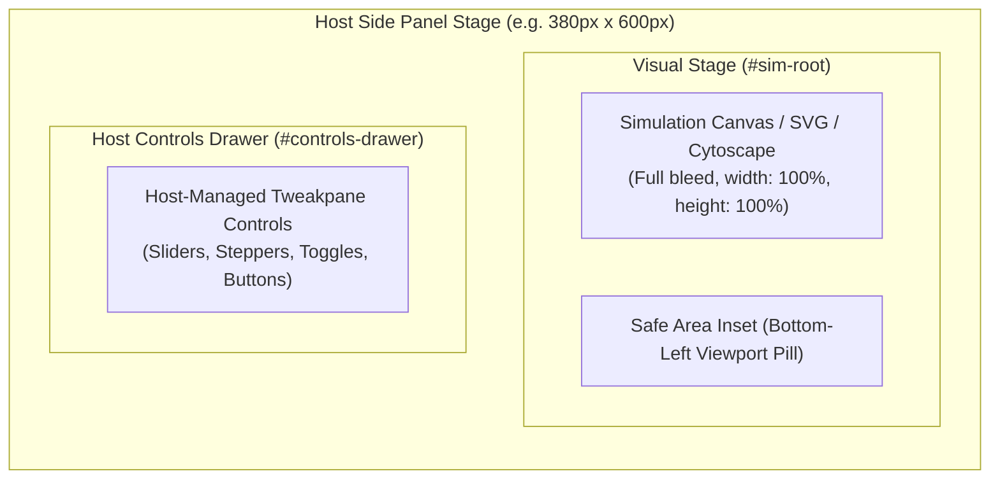

# Technical Specification: Simulation Module Contract & Stage Geometry

**Status:** Approved & Living Specification  
**Domain:** Code Generation Contract, Stage Geometry & Declarative Runtime  
**Living Document:** Permanent architectural specification under `docs/specs/`  
**Tracking Backlog:** [docs/backlog/tasks.md](file:///Users/waqqasmeraj/Developer/vmatrixdev/simit/docs/backlog/tasks.md)  
**Executable Test Suite:** [tests/module_contract.test.ts](file:///Users/waqqasmeraj/Developer/vmatrixdev/simit/tests/module_contract.test.ts)

---

## 1. Overview & Business Objectives

To eliminate boilerplate discrepancies and UI collisions, the simulation code generated by the Coder sub-agent must adhere to a strict, single-source **Simulation Module Contract**. 

Earlier iterations suffered from:
1. **Double Control Panels**: The Coder generated manual `new Tweakpane.Pane()` instances while the host simultaneously mounted controls over the simulation stage.
2. **Viewport Obscuration**: Sliders and buttons covered up to 60% of the canvas area.
3. **Prompt Drift**: Hard-won canvas sizing and styling rules in legacy prompts were stripped from the Coder sub-agent prompt.

This specification formalizes:
- **Host-Owned Controls**: All interactive controls are declared via the `parameters` array and rendered exclusively by the host outside or docked below the visual stage.
- **`StageGeometry` Injection**: Explicit stage dimensions, device pixel ratio (`dpr`), and insets (`safeArea`) are passed directly into `init(container, params, stage)`.
- **Single Source of Truth Prompting**: Both single-shot and autonomous loops utilize the identical, shared prompt section builder (`buildModuleContractPromptSection`).

---

## 2. Component Interaction & Stage Geometry

---

## 3. Contracts & Data Models

Domain models are centrally defined in [`src/types/simulation.ts`](file:///Users/waqqasmeraj/Developer/vmatrixdev/simit/src/types/simulation.ts):

- [`StageGeometry`](file:///Users/waqqasmeraj/Developer/vmatrixdev/simit/src/types/simulation.ts):
  - `width`: CSS pixel width of `#sim-root`.
  - `height`: CSS pixel height of `#sim-root` (exclusive of controls drawer and explanation bar).
  - `dpr`: Device pixel ratio clamped to `[1, 3]`.
  - `safeArea`: Inset boundaries reserved for native host overlays.
- [`SimulationExplanation`](file:///Users/waqqasmeraj/Developer/vmatrixdev/simit/src/types/simulation.ts):
  - `insight`: 1-sentence plain-English takeaway rendered in `#explanation-insight`.
  - `legend`: Array of `{ symbol, meaning, color? }` badges rendered in `#explanation-legend`.
  - `tour`: Array of `{ caption, params, highlight?, tryThis?, noticeThat? }` steps rendered in `#tour-bar` (`#btn-tour-prev`, `#tour-step-indicator`, `#tour-caption`, `#btn-tour-next`). Stepping through the tour merges `step.params` into the active parameters, refreshes Tweakpane, invokes `update(params)`, and highlights any matching element via `.simit-tour-highlight`.
- [`SimModule`](file:///Users/waqqasmeraj/Developer/vmatrixdev/simit/src/types/simulation.ts):
  - `explanation?`: Optional structured explanation and live parameter-driven guided tour.
  - `init(container, params, stage)`: Initializes simulation elements.
  - `update(params)`: Receives complete, updated parameter states.
  - `destroy()`: Disposes animation timers, listeners, and webgl contexts.

---

## 4. Single-Source Module Contract Clauses

All prompts emitted to the Coder agent must verify the presence of key architectural rules defined in [`src/runtime/module-contract.ts`](file:///Users/waqqasmeraj/Developer/vmatrixdev/simit/src/runtime/module-contract.ts):

1. **`export_shape`**: Must produce valid ES module with `export default { title, description, parameters, explanation, init, update, destroy }`.
2. **`host_owned_controls`**: Explicit prohibition against instantiating `new Tweakpane()` or manual HTML `<input>`/`<button>` tags.
3. **`parameter_types`**: Validated usage of `slider`, `toggle`, `stepper`, `select`, and `button` types.
4. **`stage_geometry`**: Backing store dimensions must derive from `stage.width * stage.dpr` and `stage.height * stage.dpr`.
5. **`theme`**: Strict adoption of `#090d16` background and high-contrast light typography (`#f8fafc`, `#38bdf8`).
6. **`animation_lifecycle`**: Animation loops must execute via `requestAnimationFrame` and cleanly terminate in `destroy()`.
7. **`explanation_tour`**: `explanation: { insight, legend, tour }` must drive the live simulation model via parameter updates (`params` passed to `update(params)`); never hardcode static frames or disconnected slides. Validated via `validateSimulationModuleContract`.

---

## 5. Behavioral Acceptance Matrix

| ID | Scenario | Given / State | When / Input | Expected Output | Verification Target |
| :--- | :--- | :--- | :--- | :--- | :--- |
| **C1** | Stage Geometry Derivation | Host viewport 400x600, drawer 44px, DPR 2 | `computeStageGeometry` evaluated | `width: 400, height: 556, dpr: 2` | `tests/module_contract.test.ts` |
| **C2** | Clause Completeness | Prompt generated via `buildModuleContractPromptSection` | Verified against `CLAUSE_PROBES` | All mandatory contract clauses (including `explanation` & live tour rule) present | `tests/module_contract.test.ts` |
| **C3** | Double Controls Prohibition | Coder prompt inspected | Searched for control directives | Contains explicit "never create a tweakpane" rule | `tests/module_contract.test.ts` |
| **C4** | Full Parameter State Delivery | User adjusts parameter slider | Host invokes module `update(params)` | Receives complete key-value dictionary, not partial diff | `tests/module_contract.test.ts` |
| **C5** | Transient Action Button Dispatch | User clicks action button (e.g. `reset`) | Host invokes `update({ reset: true })` | `reset: true` present for 1 turn; cleaned up immediately | `tests/module_contract.test.ts` |
| **C6** | Explanation Schema Validation | Module exports `explanation` object | `validateSimulationModuleContract` evaluated | Valid schema passes warning-free; malformed `explanation` or unknown tour `params` key emits `INVALID_EXPLANATION_SCHEMA` warning | `tests/module_contract.test.ts` |

